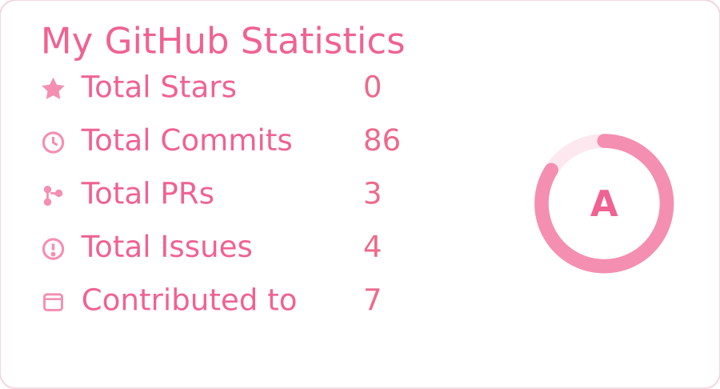
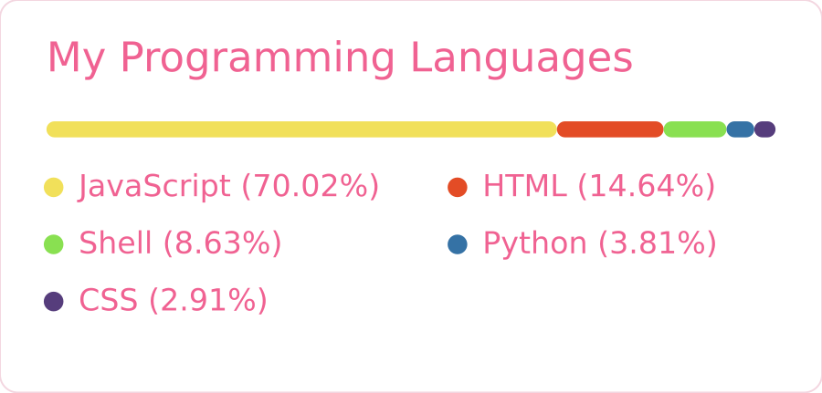

# gh-cards

自己托管的 GitHub 卡片。替代公共的 `github-readme-stats.vercel.app`。

**为什么要有这个**：公共实例是所有用户共用一份配额，随时会被限流，结果就是 README 里出现破图。用自己的 Worker + 自己的 token，配额独立；而且**出错时返回的是一张写着错误原因的图，不是破图**。

<p align="center">
  
  
</p>

（上面两张是用本仓库代码 + 模拟数据渲染出来的实际输出）

---

## 目录

1. [你会得到什么](#1-你会得到什么)
2. [准备三样东西](#2-准备三样东西)
3. [建仓库](#3-建仓库)
4. [部署到 Cloudflare](#4-部署到-cloudflare)
5. [设置 GitHub token（必须）](#5-设置-github-token必须)
6. [验证](#6-验证)
7. [绑定自己的域名（可选）](#7-绑定自己的域名可选)
8. [改 README](#8-改-readme)
9. [排错](#9-排错)
10. [成本与额度](#10-成本与额度)
11. [以后想加东西](#11-以后想加东西)

---

## 1. 你会得到什么

两个地址：

```
https://cards.sb1145148.dpdns.org/api?username=你的名字&type=stats
https://cards.sb1145148.dpdns.org/api?username=你的名字&type=langs
```

参数：

| 参数 | 说明 | 默认 |
| --- | --- | --- |
| `username` | GitHub 用户名（必填） | — |
| `type` | `stats` 或 `langs` | `stats` |
| `theme` | `dark` / `light` | `dark` |
| `langs_count` | 语言卡显示几种（1–12） | 6 |
| `hide` | stats 卡要隐藏的项，逗号分隔（`总 Star`/`仓库`/`提交(一年)`/`PR(一年)`/`Issue(一年)`/`关注者`） | 无 |

---

## 2. 准备三样东西

### ① 一个 GitHub PAT（classic，**不勾任何 scope**）

1. 打开 https://github.com/settings/tokens
2. `Generate new token (classic)`
3. Note 写 `gh-cards`，Expiration 选 90 天或更长
4. **Scopes 一个都不要勾**
5. 生成后复制 `ghp_...`（只显示一次）

不勾 scope 也能读公开数据，而配额从「无 token 的 60 次/小时」变成 **5000 次/小时**。

> ⚠️ 如果你想让卡片统计**私有仓库**，才需要勾 `repo`。多数人不必要。

### ② 一个 Cloudflare API Token

1. 打开 https://dash.cloudflare.com/profile/api-tokens
2. `Create Token` → `Custom token`
3. 权限加两条：

| 类型 | 资源 | 级别 |
| --- | --- | --- |
| Account | Workers Scripts | **Edit** |
| Account | Account Settings | Read |

4. Account Resources 选你的账号
5. 生成后复制

> 这个 token 只给 wrangler 用，不要提交到仓库。
> 如果你打算用**控制台粘贴代码**的方式部署（见 4-B），这一步可以跳过。

### ③ Node（本机跑 wrangler 时需要）

```bash
node -v     # 需要 >= 18
npm i -g wrangler
```

---

## 3. 建仓库

在 GitHub 新建一个 **public** 仓库：

```
仓库名：gh-cards
```

然后把这四个文件传上去：

```
gh-cards/
├── README.md          ← 本文件
├── wrangler.toml
├── .gitignore
└── src/
    └── index.js       ← Worker 全部代码
```

**为什么叫 `gh-cards`**：
- 语义直接（GitHub 卡片），以后加「活动图」「贡献图」也不用改名
- 不和官方 `github-readme-stats` 混淆

> 仓库 public 或 private 都行——Cloudflare 部署不读仓库，代码是直接上传的。
> 放仓库里只是为了以后能改。

---

## 4. 部署到 Cloudflare

### 4-A. 命令行（推荐）

```bash
cd gh-cards
export CLOUDFLARE_API_TOKEN=<第 2 步拿到的 token>
npx wrangler deploy
```

看到这样的输出就成功了：

```
Uploaded gh-cards (3.4 sec)
Deployed gh-cards triggers
  https://cards.sb1145148.dpdns.org
```

### 4-B. 控制台粘贴（没有 token 时用这个）

1. Cloudflare 控制台 → `Workers & Pages` → `Create` → `Start with Hello World!`
2. 名字填 `gh-cards` → `Deploy`
3. 点 `Edit code`，把 `src/index.js` 的全部内容粘进去
4. 右上角 `Deploy`

两条路效果一样，4-A 以后改代码更方便。

---

## 5. 设置 GitHub token（必须）

代码从环境变量 `GH_TOKEN` 读 token，**不要写进代码里**。

### 命令行

```bash
npx wrangler secret put GH_TOKEN
# 粘贴 ghp_... 回车
```

### 控制台

`Workers & Pages` → `gh-cards` → `Settings` → `Variables and Secrets`
→ `Add` → 类型选 **Secret** → 名字 `GH_TOKEN` → 值粘贴 token → `Save`

**名字必须完全一致：`GH_TOKEN`**（大写，下划线）。

---

## 6. 验证

```bash
# 健康检查
curl https://cards.sb1145148.dpdns.org/

# 出图（存成文件再用浏览器打开）
curl -s "https://cards.sb1145148.dpdns.org/api?username=sb1145148&type=stats" -o stats.svg
curl -s "https://cards.sb1145148.dpdns.org/api?username=sb1145148&type=langs" -o langs.svg

# 确认返回的是 SVG 而不是错误页
head -c 60 stats.svg
```

正常输出以 `<svg` 开头。

如果返回的是错误卡片，卡片上会直接写出原因（`缺少 GH_TOKEN` / `用户不存在` / `GitHub 401` 之类），**不会变成破图**。

---

## 7. 绑定自己的域名（可选）

比起 `xxx.workers.dev`，用自己的域名更短，也不受那个子域被墙的影响。

1. Cloudflare 控制台 → `Workers & Pages` → `gh-cards` → `Settings` → `Domains & Routes`
2. `Add` → `Custom domain`
3. 填 `cards.sb1145148.dpdns.org`
4. 保存

Cloudflare 会自动建 DNS 记录并签证书（你的 zone 已经在 CF 上，所以这条是全自动的）。

之后地址变成：

```
https://cards.sb1145148.dpdns.org/api?username=sb1145148&type=stats
```

> 如果走 `wrangler.toml` 配 `routes`，token 需要额外加一条
> `Zone → Workers Routes → Edit`。用控制台点一下则不需要。

---

## 8. 改 README

把主页 README 的 `## 统计` 一节替换成：

```html
<p align="center">
  
  
</p>
```

**原来那段静态图备用代码（`stats.png` / `langs.png`）建议保留**——它是最后一道保险，而且现在真能用上了（等 Actions 每天重生成一次就有意义了）。

---

## 9. 排错

| 现象 | 原因 | 处理 |
| --- | --- | --- |
| 卡片显示「卡片生成失败 / 缺少 GH_TOKEN」 | secret 没设，或名字拼错 | 第 5 步，名字必须是 `GH_TOKEN` |
| 「GitHub 401」 | token 过期或被撤销 | 重新生成 PAT，重设 secret |
| 「用户不存在」 | username 拼错 | 检查大小写 |
| 改了代码页面没变 | Cloudflare 缓存了 SVG（6 小时） | 加个 `&v=2` 参数，或等缓存过期 |
| 中文名字显示成方块 | 部分客户端缺中文字体 | 卡片里可以改成英文名（代码里 `user.name || login`） |
| 部署报 `Authentication error` | token 权限不够 | 需要 `Workers Scripts: Edit` + `Account Settings: Read` |
| 一直 500 | 看 `wrangler tail` 的实时日志 | `npx wrangler tail gh-cards` |

---

## 10. 成本与额度

| 项 | 额度 | 说明 |
| --- | --- | --- |
| Cloudflare Workers | 免费 **10 万次/天** | 你的主页一天最多几百次请求 |
| GitHub GraphQL | **5000 点/小时**（带 token） | 每次抓取约 1–2 点 |
| 缓存 | 6 小时 | 实际每天只打 GitHub 几次 |

**结论：免费额度用不完。**

> 顺带一句：缓存 6 小时意味着「今天提交的代码，卡片可能要过几小时才更新」。想立刻看最新数据，加个 `&nocache=1` 之类的参数（代码里没实现，但改 `CACHE_TTL` 或加参数都只是一行）。

---

## 11. 以后想加东西

现在的结构是「一个 fetch → 一个 query → 两个 render 函数」。想加卡片时：

1. `type` 里多一个分支（比如 `type=activity`）
2. 写一个 `activitySvg(s, theme, opts)`
3. 数据不够就扩 GraphQL `QUERY`

因为是自己托管的，**不用等别人合并 PR**，改完 `wrangler deploy` 一分钟就生效。

可能的下一步：
- 最近提交 / 最近 Release 列表
- 贡献热力图（需要拉 contributions calendar）
- 把站点文章 API 也做一张卡（`api.sb1145148.dpdns.org/api/articles`，一天一次足够）
